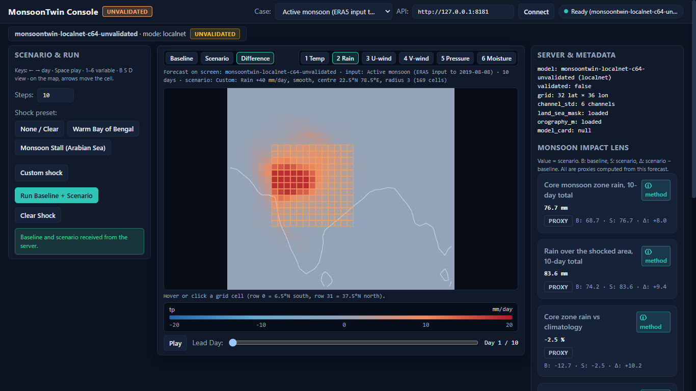

# Gridence

**Gridence — AI-Powered Monsoon Forecasting and Climate Scenario Intelligence**

*Yugaantar DevForge 2026 · Track 2 "Multiverse of Monsoon"*

Gridence is an offline "what-if" tool for India's daily weather. It takes the last three days of six surface variables on a 1° grid, forecasts the following days with a small neural network that runs on an ordinary CPU, lets you change today's conditions in one area, and shows the forecast with the change, without it, and the difference between them. It is a research prototype built for a hackathon, not a weather service.

> **Model status: UNVALIDATED.** Our measurements were made by one team member and have not been independently reproduced. Scenarios are **model simulations, not real-world weather predictions to act on**. See [Limitations](#limitations-and-validation-status).



*Live output of the running system: day-1 rain, scenario minus baseline, for a custom added-rain shock.*

## For evaluators

| I want to… | Go to |
|---|---|
| Install and run it | [Installation](#installation-windows), then [Run](#run-the-backend-and-the-dashboard) |
| Run the official validator and tests | [Tests and official validator](#tests-and-official-validator) · [test report](docs/TEST_REPORT.md) |
| Follow a demonstration | [Demonstration workflow](#demonstration-workflow) · [full runbook](docs/DEMO_RUNBOOK.md) |
| Understand the system | [How it works](#how-it-works) · [architecture](docs/ARCHITECTURE.md) · [API](docs/DASHBOARD_API.md) |
| Check the model and method | [Model and methodology](#model-and-methodology) · [model files](weights/MANIFEST.md) · [evaluation reports](eval/reports/activation/) |
| Know what not to trust | [Limitations and validation status](#limitations-and-validation-status) |
| Read the two-page brief | [Gridence_brief.pdf](docs/brief/Gridence_brief.pdf) |

The server is [`serve.py`](serve.py) at the repository root. The model weights are ordinary files in [`weights/`](weights/MANIFEST.md): no Git LFS and no download. No API key or account is needed.

## Contents

- [The problem](#the-problem)
- [Our solution and what is different](#our-solution-and-what-is-different)
- [How it works](#how-it-works)
- [Technology stack](#technology-stack)
- [Features and dashboard](#features-and-dashboard)
- [Model and methodology](#model-and-methodology)
- [Installation (Windows)](#installation-windows)
- [Run the backend and the dashboard](#run-the-backend-and-the-dashboard)
- [Tests and official validator](#tests-and-official-validator)
- [Demonstration workflow](#demonstration-workflow)
- [Limitations and validation status](#limitations-and-validation-status)
- [Repository structure](#repository-structure)
- [Acknowledgements, licence and attribution](#acknowledgements-licence-and-attribution)

## The problem
A forecast answers "what is likely?". Someone planning ahead may also ask "what if conditions here were different today?": warmer water in the Bay of Bengal, weaker monsoon winds, a burst of rain over one region. The track asks for a daily 1° India weather emulator that accepts such a localised shock, keeps its first response local, and rolls it forward, served offline within strict CPU, memory and time limits.

## Our solution and what is different
A forecast server and a separate web dashboard. You pick three past days, add a shock or none, and compare forecasts computed live. What we put effort into:

- **You can see which model answered.** Each forecast is labelled from the server's response. A fallback is reported, and no difference is drawn between forecasts that were not answered the same way.
- **You can check the numbers.** Point at any 1° cell to read baseline, scenario and difference; click it for its time series against climatology.
- **You can see how far a shock reaches.** A chart shows response energy against distance from the shocked area, using the organisers' energy definition.
- **It runs offline.** CPU only, no external service and no key; the dashboard uses no third-party code.
- **Limits are stated next to results,** including where the model is weak or fails.

These describe how the tool behaves. They are not claims of forecast skill.

## How it works
```
 dashboard/ (static HTML, CSS, JavaScript)          serve.py (FastAPI, HTTP only)              twin/ (inference)
 weather case + shock  ── POST /simulate ─────────▶  parse and validate the request ───────▶  add shock to the last input day,
 maps, charts, impact  ◀─ forecast + model header ─  encode the response           ◀───────  clamp to physical limits, roll
                          POST /health /meta /climatology                                     forward: LocalNet C64, DAP fallback
                                                                                                  ▲ weights/ (read only)
```
| Endpoint (all `POST`) | Purpose |
|---|---|
| `/health` | `{"status": "ready", "model_name": "..."}` once the model is loaded |
| `/simulate` | request `{"init_states": [3,6,32,36], "doy_sincos": [sin, cos], "steps": 1–30, "perturbation": null or [6,32,36]}`; response `{"rollout": [steps,6,32,36], "inference_ms": number}` |
| `/meta` | dashboard only: grid, channel standard deviations, static fields, model information |
| `/climatology` | dashboard only: climatology for the forecast days |

Details: [`docs/DASHBOARD_API.md`](docs/DASHBOARD_API.md). The response header `X-MonsoonTwin-Model` names the model that answered; `X-MonsoonTwin-Fallback` appears only after a fallback. Errors are 400 (not JSON) or 422 (invalid field, with the reason).

**Internal identifiers that keep the earlier name:** the two response headers above, the model IDs `monsoontwin-localnet-c64-unvalidated` and `monsoontwin-dap-unvalidated`, the checkpoint format tag inside `localnet.pt`, the browser storage key for the server address, test fixtures, and code comments in the backend. The dashboard shows readable model names ("LocalNet C64 (unvalidated)") and lists the exact ID under **Technical details**.

**One run, step by step**
1. The dashboard asks the server for its status and grid information (`/health`, `/meta`).
2. You choose the input days, a length and optionally a shock. The dashboard builds the shock as a `[6, 32, 36]` change in physical units.
3. It requests a **baseline** (`perturbation: null`) and, if there is a shock, a **scenario** from the same inputs.
4. The server validates each request, adds the shock to the last input day only, limits values to physical ranges, and rolls the model forward one day at a time.
5. The dashboard also requests climatology, computes **scenario − baseline** and the impact proxies in the browser, and draws them.

Full description with a diagram: [`docs/ARCHITECTURE.md`](docs/ARCHITECTURE.md).

## Technology stack
| Part | Used |
|---|---|
| Server | Python 3.10+, FastAPI, Uvicorn, NumPy |
| Model | PyTorch (CPU for serving; no GPU needed) |
| Dashboard | Plain HTML, CSS and ES modules; SVG and canvas charts; no framework, no CDN, no build step |
| Training and evaluation | SciPy, xarray, netCDF4, the organisers' `monsoon_r1` kit |
| Tests | pytest, Node's built-in test runner, headless Edge or Chrome |

## Features and dashboard
| Area | What it does |
|---|---|
| Inputs | Four real 3-day input states from 2018–2019 and a labelled synthetic test input; forecast length 5, 10, 14 or any whole number from 1 to 30 |
| Shocks | The organisers' Warm Bay of Bengal and Monsoon Stall shocks, or custom rectangle or smooth shocks; the map shows where a shock applies |
| Map | Baseline, Scenario and Difference for six variables; day slider, arrows and playback; cell readout; city and coastline reference; fitted or fixed colour range with a stated clipping share; optional, labelled smoothing |
| Analysis | Per-cell series against climatology; response energy against distance; impact **proxies** (core-monsoon-zone rain, rain over the shocked area, departure from climatology, heavy-rain and warm cell-days), each with its method and limitation |
| Honesty and safety | Model and Unvalidated status shown; before a forecast the map is labelled "not a forecast"; old results are removed when inputs change or a request fails |

Optional keys: ← → day · Space play/pause · 1–6 variable · B S D view.

## Model and methodology

### Data and inputs
- **Grid:** 32 × 36 cells of 1°, centres 6.5–37.5°N (row 0 = south) and 65.5–100.5°E. Daily values.
- **Channels, in order:** `t2m` K, `tp` mm/day, `u10` m/s, `v10` m/s, `msl` Pa, `tcwv` kg/m². Physical units everywhere.
- **Forecast input:** three consecutive days and `doy_sincos`, the sine and cosine of the day of year of the **last** input day (1 = 1 January; the contract does not state the base). `rollout[k]` is day k+1.
- **Training data:** the organisers' `india_climate_train.nc` (ERA5-based), SHA-256 `f37bdbd0bd44e6fe951adf36c9a08620075f9d17de391b04c97d61f06797903b`. It is **not** in the repository and is not needed to run Gridence.
- **Split:** network training 2005–2015; model choices 2016–2017; frozen validation 2018–2019; test years 2020–2021 **not used**.
- **Included inputs:** [`dashboard/cases/`](dashboard/cases/) holds four real 3-day input states from 2018–2019 (inputs only, no targets or forecasts), chosen by fixed rules by `tools/make_demo_cases.py`. A clearly labelled synthetic input is also available. All forecasts are computed live.

### Models
**LocalNet C64 (served).** A 313,735-parameter residual CNN: 3×3 stem, four residual blocks, 64 channels, per-cell layer normalisation, no down-sampling or global layers. It predicts one-day changes (rain in log1p space) from the last 3 days, the target day's climatology, land–sea mask, orography and calendar features, one day at a time. Trained on 2005–2015: one-step training, then 2- and 4-step rollout fine-tuning. `weights/model_select.json` names the checkpoint by hash; all model files come from one training run ([`weights/MANIFEST.md`](weights/MANIFEST.md)).

**DAP (fallback).** Damped anomaly persistence, for each variable and cell: `forecast(d+k) = climatology(d+k) + φ^k × (last input − climatology(d))`, fitted on 2005–2015. It cannot drift, and it **cannot spread a shock**.

| When | What answers | How you can tell |
|---|---|---|
| `torch` or the checkpoint cannot be loaded at start-up | DAP for every request | `model_name` is `monsoontwin-dap-unvalidated` |
| A runtime error during a request | DAP for that whole request | `X-MonsoonTwin-Fallback: whole-request-fallback` |
| A non-finite LocalNet step | one DAP step inside the forecast | `X-MonsoonTwin-Fallback: repaired-steps=n` |

The dashboard does not draw a difference between forecasts that were not answered the same way. A fallback does **not** protect against a slow or memory-limited machine, or against a poor but finite forecast.

### Local results
**Measured locally by one team member and not independently reproduced by a second person. This replicates part of the automatic scoring; it is not the competition score.** The judge uses other windows and does not publish how it averages.

| 46 forecast windows and 6 × 2 shock tests, 2018–2019 | LocalNet (served) | DAP fallback |
|---|---|---|
| All outputs valid; zero shock identical; deterministic | pass | pass |
| Mean day-4 skill against persistence | +0.249 | +0.196 |
| Local replica, RMSE skill (of 30) · heavy rain (of 15) | 29.5 · 0.8 | 16.4 · 0.0 |
| Local replica, anti-blur (of 10) · shock causality (of 15) | 9.45 · 13.4 | 10.0 · 11.25 |
| **Local replica total (of 70)** | **53.2** | **37.7** |
| Heavy-rain CSI at day 1 · 4 · 8 | 0.34 · 0.20 · 0.15 | 0.30 · 0.18 · 0.22 |
| Shocks non-zero and local on day 1 | 12/12 | 12/12 |
| Shocks spreading outward: warm ocean · monsoon stall | **6/6 · 2/6** | 0/6 · 0/6 |
| Shocks within the stability limit | **11/12** | 12/12 |

Against the better of persistence and climatology, LocalNet is clearly ahead at day 1 (+0.25 to +0.34), mostly slightly ahead at day 4 (pressure is −0.03), and **behind on every variable at day 8** (−0.02 to −0.12), where it is also behind DAP. Day-8 spatial variance as a share of the real one: t2m 0.99, **tp 0.27**, u10 0.75, v10 0.77, msl 0.96, tcwv 0.94. Source: [`eval/reports/activation/`](eval/reports/activation/).

### Runtime
Measured on a Windows laptop (i5-13450HX), server restricted to 4 logical processors, over HTTP, with two CPU-only PyTorch builds. **Not measured on Linux or on the judge's hardware.**

| LocalNet | torch 2.15.0+cpu | torch 2.6.0+cpu | Limit |
|---|---|---|---|
| Process start to ready | 3.4 s | 3.4 s | 120 s |
| 10-step request, slowest of 12, including JSON | 133 ms | 155 ms | 5 s |
| 30-step request, slowest of 12 | 329 ms | 354 ms | |
| Peak memory of the server process | 262 MB | 241 MB | 6 GB |

The slowest 10-step call measured in any run was 191 ms (2.6.0+cpu, a second run that mixed shocks and forced fallbacks). On four demo cases, 2.15.0+cpu matched the 2.14.1 build used in training bit for bit (on the CPU); 2.6.0+cpu differed by at most 0.00004 standard deviations over 10 days and 0.0005 over 30. Older PyTorch releases are untested. The server made no outbound connection attempt and ran from a read-only copy of the repository.

### Baseline and scenario
- **Baseline:** the forecast from the three input days, unchanged (`perturbation: null`).
- **Shock:** a change in physical units added to the **last input day only**; the server then limits values to physical ranges.
- **Scenario:** the forecast from the shocked input. A zero shock gives output bit-identical to the baseline.

| Official shock | Area (cell centres) | Change |
|---|---|---|
| Warm Bay of Bengal | 8.5–19.5°N, 82.5–93.5°E (12 × 12) | temperature +3.0 K; water vapour +15 % of each cell's value |
| Monsoon Stall (Arabian Sea) | 8.5–19.5°N, 65.5–74.5°E (12 × 10) | both wind components −40 % |

**Custom shock:** one variable at a time, add or percentage change, rectangle or smooth blob; several parts can be added together. It replaces a selected official shock rather than combining with it.

### Difference
`Difference = Scenario − Baseline`, cell by cell, for every day and variable, computed in the browser from the two server responses. **Orange:** higher with the shock. **Blue:** lower. **Dark:** little or no change. The colour range is symmetric about zero and the same for all days of a run, so late differences can look faint; point at a cell to read the numbers. "How far the shock reaches" plots the organisers' measure of response energy against distance from the shocked area.

## Installation (Windows)
Requires **Python 3.10 or newer** and Git. Internet is needed only to install packages. No dataset and no model download is needed.

**Windows (PowerShell)**
```powershell
git clone https://github.com/shashankedu02/yugantar-monsoon-kit
cd yugantar-monsoon-kit
python -m venv .venv
.\.venv\Scripts\python.exe -m pip install -r requirements.txt
```
**Linux or macOS**
```bash
git clone https://github.com/shashankedu02/yugantar-monsoon-kit
cd yugantar-monsoon-kit
python3 -m venv .venv
.venv/bin/python -m pip install -r requirements.txt
```
For a smaller CPU-only PyTorch on Linux, first run `.venv/bin/python -m pip install torch --index-url https://download.pytorch.org/whl/cpu`.

**Windows long paths:** PyTorch contains very long file names. If `pip` fails with `OSError: [Errno 2] No such file or directory` inside `torch\include`, clone into a short folder (for example `C:\g`) or enable Windows long-path support, then install again.

We have run these steps on Windows only. **Linux and macOS are untested.**

## Run the backend and the dashboard
Terminal 1, backend:
```powershell
.\.venv\Scripts\python.exe serve.py --port 8000        # Linux/macOS: .venv/bin/python serve.py --port 8000
```
Terminal 2, dashboard:
```powershell
.\.venv\Scripts\python.exe -m http.server 5500 -d dashboard      # Linux/macOS: .venv/bin/python -m http.server 5500 -d dashboard
```
Open **http://localhost:5500** and press **Ctrl+F5** (this simple file server lets a browser keep old files). The header must say **Ready (LocalNet C64 (unvalidated))**. If it says DAP, LocalNet did not load; terminal 1 gives the reason (usually `torch` is missing). If port 8000 is taken, stop the old server first, or start on another port and enter its address under **Connection**.

## Tests and official validator
With the server running, in a third terminal:
```powershell
.\.venv\Scripts\python.exe -m pip install requests third_party/monsoon_r1_kit-1.0.0-py3-none-any.whl
.\.venv\Scripts\python.exe -m monsoon_r1.schema_validator http://localhost:8000
```
(Linux/macOS: use `.venv/bin/python`.) It should end with `RESULT: all checks passed`. Results of our own runs are recorded in [`docs/TEST_REPORT.md`](docs/TEST_REPORT.md).

<details><summary>Full test suite (developers)</summary>

```bash
pip install -r requirements-train.txt third_party/monsoon_r1_kit-1.0.0-py3-none-any.whl
python -m pytest -q                       # contract, engine, models, server, shock presets
node --test tests/js/*.test.mjs           # dashboard logic, colour scales, names (Node 22 or newer)
node tests/e2e/integration.e2e.mjs        # real browser + real server (Edge or Chrome)
node tests/e2e/dashboard.e2e.mjs          # colours, charts, layout, keyboard, safety
node tests/e2e/scenarios.e2e.mjs          # cases, shocks, impact numbers
node tests/e2e/ux.e2e.mjs                 # first use, branding, legend, pointer, narrow screens
python tools/preflight.py                 # tracked files, secrets, official repository scan, tests
```
Browser tests use `PYTHON` (an interpreter with the server requirements) and `BROWSER` (path to Edge or Chrome) if the defaults do not fit.
</details>

<details><summary>Reproducing training and evaluation</summary>

Put the dataset at `data/india_climate_train.nc` (ignored by Git) and check its SHA-256 (see [Data and inputs](#data-and-inputs)).
```bash
python -m training.data                                              # validate the dataset
python -m training.localnet_data    --nc data/india_climate_train.nc
python -m training.fit_dap_baseline --nc data/india_climate_train.nc
python -m training.train_localnet   --nc data/india_climate_train.nc --run runs/localnet_c64/run1
python -m eval.compare --nc data/india_climate_train.nc --candidate weights --baseline runs/tune/dap_baseline --out eval/cache/compare
```
Candidate model files appear in `runs/localnet_c64/run1/candidate/`. `localnet_data` also rewrites `weights/static.npz` and `weights/norm.json`. `eval.compare` rejects a run if any call falls back to DAP, and exits with code 2 because not every shock check passes. The shipped run took under 10 minutes on an NVIDIA RTX 3050 laptop GPU (see the comment in `requirements-train.txt`); its record is `eval/reports/activation/training_run_record.json`. We have **not** shown that retraining gives a byte-identical checkpoint; the climatology, normalisation and DAP coefficients are exactly reproducible.

**Do not run `python -m training.fit_dap` on this checkout:** it fits the earlier 2005–2017 DAP and overwrites two files of the shipped model package, after which LocalNet refuses to load.

Validation windows are frozen in `eval/windows_val.json`. Some code comments cite planning documents that are no longer in the tree; they remain in the Git history (commit `7b12fe1`).
</details>

## Demonstration workflow
Full script: [`docs/DEMO_RUNBOOK.md`](docs/DEMO_RUNBOOK.md). Short version:
1. Choose the case **Weak monsoon spell** and keep 10 days.
2. Click **Warm Bay of Bengal**; the map outlines what the shock adds.
3. Click **Run Baseline + Scenario**.
4. The map stays on **Baseline**. Click **Scenario**, then **Difference**.
5. Step from day 1 to day 8, switch variables (Temperature and Moisture first), point at a cell to read baseline, scenario and Δ, and click it for its chart.

Scenario and Difference stay greyed out until a run with a shock has finished. Changing the shock, case or length removes the old scenario: run again. A custom shock counts only after **Add to shock**. On the opening case, "Active monsoon", neither official shock spreads by the organisers' check; the runbook lists which cases do.

## Limitations and validation status
- **Unvalidated.** None of our measurements has been reproduced by a second person.
- **Shock responses are not verified physics.** In 6 test windows the monsoon-stall shock spread outward in only 2; the warm-ocean shock in 6 of 6. We make no claim about direction or speed.
- **One stability failure:** warm-ocean shock, window starting 2018-05-22: day-6 rain at 19.5°N 87.5°E changed from 57.0 to 6.6 mm/day (6.7 standard deviations; the limit is 5).
- **Added rain fades quickly**; later days can have the opposite sign, so a multi-day total can hide the daily response.
- **Day 8 is weak:** behind the better of persistence and climatology, and behind DAP, on all six variables. Rain is visibly smoothed; heavy-rain skill is near zero.
- Far outside real weather the output is meaningless: unrealistic inputs drove rain to the 1000 mm/day safety limit. Moisture can reach exactly zero at some high-altitude cells. The causes of these weaknesses have not been established.
- 1° daily grid means: not station rain, not daily maximum temperature, **not a flood or heatwave warning**. Impact indicators are proxies. The monsoon-break index is not computed.
- **Dashboard:** emptying the days box gives 1 day; one custom part cannot be removed on its own; the cell readout clears when the pointer leaves; a warning message floats over the toolbar until dismissed.
- **Not tested:** Linux, macOS, browsers other than Edge, touch devices, screen readers.
- The server has no authentication and allows any origin, as needed for a local offline dashboard.

## Repository structure
```
serve.py                 HTTP server (the organisers' contract)
requirements.txt         what is needed to run (includes requirements-serve.txt)
requirements-train.txt   training, evaluation and test extras
twin/                    inference package
weights/                 model files, plain Git (see weights/MANIFEST.md)
dashboard/               web dashboard, demo input cases, reference coastline
training/                dataset checks, climatology, DAP and LocalNet training
eval/                    scoring replica, shock battery, frozen windows, activation reports
tests/                   Python, JavaScript and browser tests
tools/                   preflight, demo-case extraction, brief figure and PDF
docs/                    architecture, API reference, test report, demo runbook, two-page brief
third_party/             the organisers' kit wheel (validator, scorer)
```

## Acknowledgements, licence and attribution
- **Organisers:** the challenge, the training dataset and the scoring kit.
- **Development assistance:** parts of the code and documentation were developed with the AI coding assistant Claude Code; commits made with it carry a co-author line.

**No open-source licence has been chosen for this project's own code**, so no reuse rights are granted beyond what the competition requires.

- **Weather data:** the training data and demo inputs come from the organisers' [yug-monsoon-kit](https://github.com/OfficialAbhinavSingh/yug-monsoon-kit). Per its NOTICE:

  > Contains modified Copernicus Climate Change Service information (ERA5, Hersbach et al. 2020), accessed through Google WeatherBench 2 (Rasp et al. 2024). ERA5 is licensed under CC BY 4.0. Fields were regridded to 1 degree, averaged to daily values and to a 32 x 36 half-degree-centred grid over 6.5N-37.5N, 65.5E-100.5E.

  Neither the European Commission nor ECMWF is responsible for any use of this information.
- **Organisers' kit:** the wheel in `third_party/` is the organisers' work, included so the validator can be run.
- **Coastline:** Natural Earth 1:50m, public domain ([details](dashboard/vendor/LICENSES.md)). No political boundaries are drawn.
