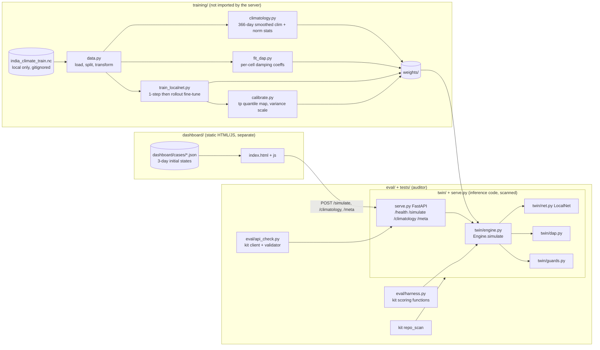

# System architecture

Status: **design, approved for build once the team signs off.**
- Nothing here is implemented yet.
- Numbers marked *(target)* are budgets, not measurements.
- Why we chose this design is in `MODEL_STRATEGY.md` and `DECISION_LOG.md`.

## 1. One-paragraph summary
**MonsoonTwin** is a deterministic, autoregressive, **local residual convolutional emulator** (LocalNet).
- **Each daily step:** it reads the last 3 days plus the static maps and the climatology for the target day, and predicts the change to the next day.
- **Locality:** its per-step reach is bounded: a 3×3 stem plus 4 residual blocks of two 3×3 convs gives ≤ 9 cells along rows and columns, about 12.7 cells diagonally. That makes the judge's locality and no-teleport tests likely to pass **[UNVERIFIED]**, but **not guaranteed**. The shock battery measures them for every candidate.
- **Fallback:** a statistical **Damped Anomaly Persistence (DAP)** model is bundled. It serves if LocalNet is not ready, and it also replaces any step that comes out non-finite.
- **Wrapper:** a thin FastAPI server exposes the contract. A separate static HTML/JS dashboard calls the same `/simulate` live for scenarios, ensembles and the Monsoon Impact Lens.

## 2. Component diagram



## 3. Repository layout and ownership

```
monsoon-twin/                     owner
├── serve.py                      B2   HTTP only: parse, validate, call Engine, encode
├── twin/                         B1   INFERENCE PACKAGE: everything serve.py imports
│   ├── __init__.py
│   ├── engine.py                 B1   Engine: load weights, perturb, roll out, guard, post-process
│   ├── net.py                    B1   LocalNet nn.Module (also imported by training/)
│   ├── dap.py                    B1   damped anomaly persistence
│   ├── doy.py                    B1   doy_sincos -> climatology index (no calendar dates)
│   ├── transforms.py             B1   normalise / log1p(tp) / inverse
│   └── guards.py                 B1   physical clamps, finite checks
├── weights/                      B1   model.pt, climatology.npz, dap.npz, static.npz, norm.json, stats.json (organisers' copy), calib.json, model_card.json, MANIFEST.md
├── training/                     B1   data.py, climatology.py, fit_dap.py, train_localnet.py, calibrate.py, export.py, configs/*.yaml
├── eval/                         AUD  harness.py, shock_battery.py, api_check.py, timing.py, report.py
├── tests/                        AUD  pytest: contract, null shock, determinism, guards, repo scan
├── dashboard/                    B2   index.html, css/, js/ (api, render, wind, scenario, impact, ensemble), vendor/, cases/
├── tools/                        B2   make_demo_cases.py (reads local .nc and writes dashboard/cases/)
├── docs/                         SHARED (PR, AUD merges); docs/brief/ owned by AUD
├── README.md  CLAUDE.md  requirements-train.txt  requirements-serve.txt  .gitignore  LICENSE
```

**Hard dependency direction.**
- `training/`, `eval/` and `tools/` may import `twin/`.
- `twin/` and `serve.py` must **never** import `training/`, `eval/`, `tools/`, the kit package `monsoon_r1`, or anything outside the sandbox library list.

## 4. Interface contracts

### 4.1 Engine (owned by B1, consumed by B2, AUD)
```python
class Engine:
    model_name: str                       # e.g. "monsoontwin-localnet-v1" or "monsoontwin-dap-v1"
    def __init__(self, weights_dir: pathlib.Path, prefer: str = "localnet"): ...
        # loads everything and runs one warm-up rollout.
        # Raises if climatology/DAP/static/stats files are missing, so the server never reports ready.
        # A missing or corrupt LocalNet file is NOT fatal: it falls back to DAP and model_name says so.
    def simulate(self, init_states: np.ndarray,      # float32 [3,6,32,36], physical units, oldest first
                 doy_sincos: tuple[float, float],    # of init_states[-1]
                 steps: int,                         # 1..30 (judge uses 10)
                 perturbation: np.ndarray | None     # float32 [6,32,36] physical delta or None
                 ) -> np.ndarray: ...                # float32 [steps,6,32,36], physical, finite, guarded
    def climatology(self, doy_sincos, steps) -> np.ndarray: ...   # [steps,6,32,36] for lead days 1..steps
    def static_fields(self) -> np.ndarray: ...                    # [2,32,36] land_sea_mask, orography_m
    def core_zone_rain_stats(self, doy_sincos, steps) -> tuple[np.ndarray, np.ndarray]: ...  # mean, std of core-zone (18–28 N, 65–88 E) daily rain for lead days 1..steps
    def channel_std(self) -> list[float]: ...                     # the organisers' stats.json std, verbatim (judge units)
    def model_card(self) -> dict: ...                             # loaded from weights/model_card.json
```
**Guarantees:**
- Deterministic: same inputs give a bit-identical output.
- `perturbation=None` and `perturbation=zeros` give identical outputs.
- No file writes, except to `/tmp` if ever needed.
- Steps until LocalNet is ready:
  - **H1:** `Engine` returns persistence. This is the contract stub.
  - **~H5:** it returns DAP.
  - **~H14:** it returns LocalNet.

### 4.2 HTTP (owned by B2)
| Endpoint | Request | Response | Notes |
|---|---|---|---|
| `POST /health` | – (POST, no body) | `{"status":"ready","model_name":...}` | Says ready only after the Engine has loaded and warmed up. **POST is required** (kit contract, template and client); the dashboard's API indicator also uses POST. |
| `POST /simulate` | contract body | `{"rollout":[steps,6,32,36],"inference_ms":float}` | Judge-facing. Accepts lists, tolerates `{"b64","shape"}`. |
| `POST /climatology` | `{"doy_sincos":[s,c],"steps":n}` | `{"climatology":[n,6,32,36], "core_zone_rain_mean":[n], "core_zone_rain_std":[n]}` (from `Engine.climatology` and `Engine.core_zone_rain_stats`) | Dashboard only (anomalies, impact lens; core zone 18–28 N, 65–88 E) |
| `POST /meta` | – | grid (lat/lon centres), channel names and units, `Engine.channel_std()` (organisers' stats.json std, the judge's units, for the shock-energy chart), `land_sea_mask`, `orography_m`, `Engine.model_card()` | Dashboard only (coastline drawn from the land-sea mask) |

**Server behaviour:**
- Malformed input returns HTTP 422 with a message. It never crashes.
- CORS: `CORSMiddleware(allow_origin_regex=r"http://(localhost|127\.0\.0\.1)(:\d+)?", allow_methods=["POST"], allow_headers=["*"])`. Starlette has no port wildcard in `allow_origins`.
- All dashboard endpoints get their data from `Engine` methods. `serve.py` never reads files in `weights/` directly.
- Torch: `torch.set_num_threads(4)`, `torch.inference_mode()`.
- Host `0.0.0.0`, port from `--port`.

### 4.3 Wire / units
- Physical units everywhere outside the `twin/transforms.py` boundary.
- Channel order: `t2m, tp, u10, v10, msl, tcwv`.
- Grid arrays are always `[..., lat(32, S→N), lon(36, W→E)]`.

## 5. Inference data flow (one `/simulate` call)
1. `serve.py` decodes the JSON to float32 arrays and validates shapes, finiteness, `steps`, and `len(doy_sincos)==2`.
2. `Engine.simulate`:
   - `x = init_states.copy()`. If `perturbation` is given, `x[-1] += perturbation`.
   - Clamp `x` to physical ranges (`guards.clamp_state`), so a live judge shock that makes tp < 0 is still valid.
   - `d0 = doy.from_sincos(doy_sincos)`.
   - For k = 1..steps:
     - Build the input: the 3 normalised states, clim(d0+k), the static maps, sin/cos(d0+k), latitude, and edge distance.
     - Run LocalNet to get the tendency, and add it to the last state (tp is handled in log1p space).
     - Inverse-transform and clamp.
     - If the result is non-finite, replace this step with the DAP step and log a warning.
     - Append, and shift the 3-day window.
   - Apply post-processing to the outputs only (calibration from `calib.json`, per lead). The autoregressive state is never post-processed.
   - **Final clamp** (`guards.clamp_state`) on every output step after post-processing, because a rescale or quantile map must never produce negative rain.
3. `serve.py` encodes with `.astype(float32).tolist()` and returns it with `inference_ms`.

**Time budget** *(target)*:
- Target ≤ 1.5 s for 10 steps on 4 CPU threads including JSON **[UNVERIFIED]**; compute ~0.8 GMAC/step **[ESTIMATED]**; acceptance ≤ 2 s in the sandbox rehearsal. The judge allows 5.0 s.
- Measured by `eval/timing.py` with `taskset`/`torch.set_num_threads(4)`.

## 6. Training data flow
- **Load:** `training/data.py` loads `india_climate_train.nc` with xarray.
- **Split by year:**
  - train 2005–2017
  - validation 2018–2019
  - test 2020–2021, untouched until the final check
- **Final model:** the model selected on validation is shipped as-is. There is no retrain on all years, since that would invalidate the validation-fitted calibration and the battery results (decision D-17).
- **Climatology and statistics:**
  - Per-calendar-day mean with a 15-day circular smoothing, matching the judge's recipe → `climatology.npz` [366,6,32,36].
  - Normalisation statistics, including log1p(tp) and per-channel tendency std → `norm.json`.
  - Per-day-of-year mean and std of core-zone (18–28 N, 65–88 E) daily rain, 366 values each, for the Monsoon Break Watch → stored in `climatology.npz`.
- **Samples:** windows of 3 input days plus K target days. K = 1 for pre-training and 2–4 for rollout fine-tuning.
- **Outputs:** weights, the DAP coefficients and calibration files go into `weights/`. `weights/MANIFEST.md` records the git commit, config, data split and validation scores.

## 7. Dashboard data flow
- **Initial states:** loaded from `dashboard/cases/*.json`.
  - Each holds 3 days × 6 × 32 × 36 plus a label and doy_sincos, generated by `tools/make_demo_cases.py` from the validation years (2018–2019).
  - At most 8 cases, which is well under the archive rule.
- **Calls:** baseline `/simulate` with `perturbation: null`, and scenario `/simulate` with the user's painted shock.
- **Ensemble:** N calls with small, spatially smooth initial-state perturbations, sent as `perturbation` fields from the browser.
- **Anomalies and impacts:** use `/climatology`.
- **Rule:** every pixel shown is computed from those live responses. Nothing is pre-rendered. Detail in `UI_UX_SPECIFICATION.md`.

## 8. Failure containment
| Failure | Containment |
|---|---|
| LocalNet weights missing or corrupt at start-up | Engine falls back to DAP; `model_name` says so; a startup log line is written |
| Non-finite step | That step is replaced by the DAP step from the same state |
| Out-of-range values | Clamped (t2m 233.2–333.1 K, tp 0–1000, \|u\|,\|v\| ≤ 60, msl 85,000–110,000, tcwv 0–100) |
| Oversized `steps` | Rejected above 30 (422) |
| Slow call | Fixed-cost model with no data-dependent loops; timing test in CI |
| Bad JSON / shape | 422 with a message |

## 9. What is deliberately NOT in the architecture
- No global mixing layers: no FFT/AFNO, global attention, U-Net down/up-sampling, global pooling, or GroupNorm/InstanceNorm. All of these can spread a local change across the grid in one step, which would break day-1 locality **[ESTIMATED from architecture; not measured]** (`SHOCK_AND_DYNAMICS.md`).
- No stochastic inference on the judged path. Ensembles exist only in the dashboard.
- No data archive, dates, `.nc` files or external API in the repo's inference code.
