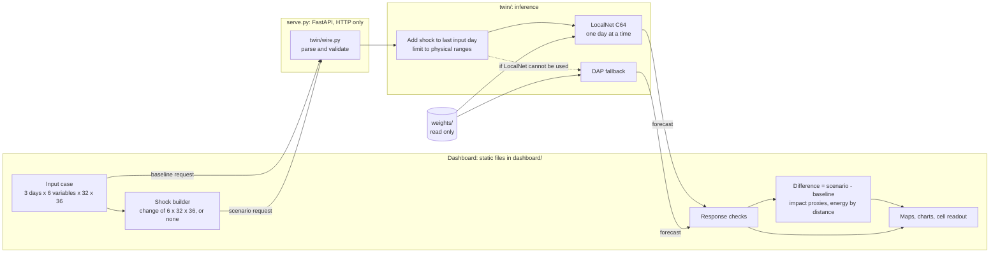
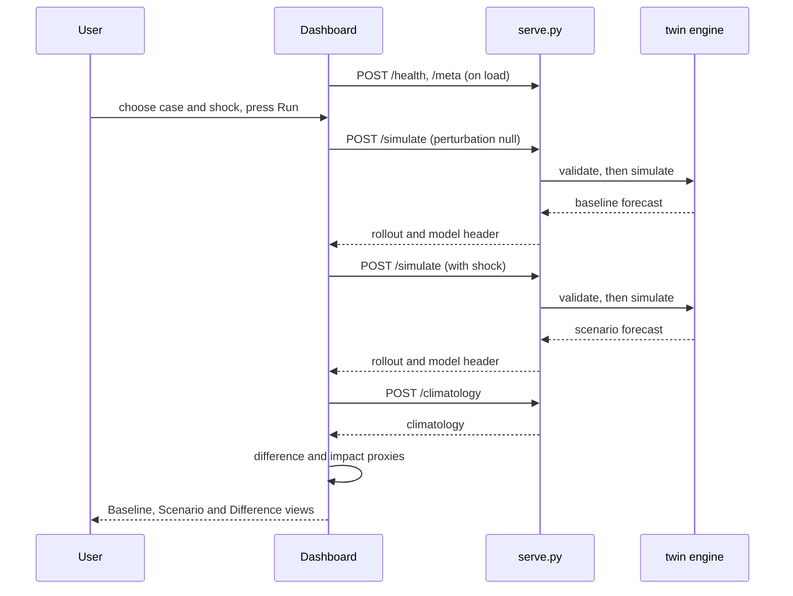

# Gridence architecture

How the shipped system works. Setup is in the [README](../README.md); request and response formats are in [DASHBOARD_API.md](DASHBOARD_API.md). The model is **unvalidated**: its output is a model simulation, not a weather prediction to act on.

## Overview

Arrows back to the browser pass through `serve.py`, which encodes the forecast as JSON and names the model in a response header.

The two parts run as separate processes: the API server on port 8000 and any static file server for `dashboard/`. Neither calls an external service.

## Frontend
Plain HTML, CSS and ES modules, with no framework, build step or third-party code.

| Module (`dashboard/js/`) | Role |
|---|---|
| `app.js` | Wires the page together |
| `api.js` | Calls the server one request at a time, with a 15 s timeout |
| `validate.js` | Checks the shape and values of each response |
| `state.js` | Holds one snapshot per run; computes the difference; drops results when inputs change |
| `cases.js`, `scenario.js`, `config.js` | Input cases, shock construction and limits, grid and channel constants |
| `analysis.js` | Response energy by distance and the impact proxies |
| `render.js`, `contour.js`, `scale.js`, `geo.js` | Map drawing, colour ranges, reference coastline |
| `ui/`, `copy.js` | Legend, charts, cards, status; plain-language text |

Values are never changed in the browser; only their colouring is chosen there.

## Backend
`serve.py` does HTTP only. It loads one `Engine` at start-up, and `/health` is reachable only after the model has loaded and passed a warm-up forecast. It listens on all interfaces (`0.0.0.0`), allows any origin and has no authentication, which suits a local offline demonstration and not an exposed network.

`twin/wire.py` accepts arrays as nested JSON lists or base64 float32, requires exact shapes and finite numbers, and limits `steps` to 1–30. It never repairs bad input: malformed JSON gives 400, an invalid field gives 422 with the reason.

## Input data
| Item | Value |
|---|---|
| `init_states` | `[3, 6, 32, 36]`: three consecutive days, oldest first, physical units |
| Channels | `t2m` K, `tp` mm/day, `u10` m/s, `v10` m/s, `msl` Pa, `tcwv` kg/m² |
| Grid | 1°, cell centres 6.5–37.5°N (row 0 is south) and 65.5–100.5°E |
| `doy_sincos` | Sine and cosine of the day of year of the **last** input day, on a 365-day calendar |

The dashboard's cases in `dashboard/cases/` are inputs only. The server never reads them, and it needs no dataset at run time.

## Model and inference pipeline
At start-up `twin/engine.py` reads `weights/model_select.json`, checks the SHA-256 of the selected checkpoint, checks that it was trained with the shipped climatology, loads it on the CPU (4 threads) and runs a warm-up forecast. If any step fails, it serves DAP and reports `monsoontwin-dap-unvalidated`.

For each request:
1. If a perturbation is given and is not all zero, add it to the last input day. Days one and two are not changed.
2. Limit the shocked day to physical ranges (`twin/guards.py`).
3. **LocalNet** (`twin/net.py`) builds 30 input channels: three normalised past states (18), the target day's climatology (6), land–sea mask and scaled orography (2), the target day's sine and cosine (2), latitude and distance to the domain edge (2). Rain is handled as log1p.
4. A 3×3 stem and four residual blocks (per-cell layer normalisation, 3×3 convolutions, replicate padding; no down-sampling or global layers) predict the **change** from the latest day. A seventh output, a heavy-rain score, is used only in training.
5. The new day is limited to physical ranges and fed back as input for the next day.
6. The final output is limited again and checked for non-finite values.

**DAP**, the fallback, works cell by cell: `climatology(d+k) + φ^k × (last input − climatology(d))`. It cannot carry a shock from one cell to another.

| Fallback | What happens | Reported as |
|---|---|---|
| LocalNet cannot be loaded or warmed up | DAP answers every request | model name |
| LocalNet raises an error during a request | The whole request is answered by DAP; partial output is never mixed in | `X-MonsoonTwin-Fallback: whole-request-fallback` |
| One LocalNet step is not finite | That step is replaced by one DAP step | `X-MonsoonTwin-Fallback: repaired-steps=n` |

## Baseline, scenario and difference
| Term | How it is made |
|---|---|
| Baseline | `/simulate` with `perturbation: null` |
| Scenario | `/simulate` with the same inputs and a non-zero perturbation |
| Difference | `scenario − baseline` for every day, variable and cell, computed in `state.js` |

A zero perturbation gives output bit-identical to none. The difference is computed only when both responses came from the same model without a fallback.

The official shocks (the organisers' definitions) and custom shocks are described in the [README](../README.md#baseline-and-scenario). **Response energy** for a day and cell is the sum over the six channels of `(difference / channel standard deviation)²`, shown against distance from the shocked cells. Impact indicators are computed in the browser from the arrays on screen and are labelled as proxies.

## API communication
All endpoints are `POST` with JSON.

| Endpoint | Used by | Returns |
|---|---|---|
| `/health` | Evaluator and dashboard | `status`, `model_name` |
| `/simulate` | Evaluator and dashboard | `rollout [steps, 6, 32, 36]`, `inference_ms`; model headers |
| `/meta` | Dashboard | Grid, channel standard deviations, static fields, model information |
| `/climatology` | Dashboard | Climatology for the forecast days |

## Data flow for one scenario run

